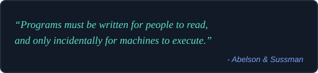

<!-- Put README.md in repo  Rutvikp-07/Rutvikp-07  and keep the 3 SVGs in an  assets/  folder next to it -->



<div align="center">


<a href="https://github.com/Rutvikp-07"></a>

</div>

## 🎯 About Me

<table>
<tr>
<td width="62%" valign="top">

```js
const rutvik = {
  role:      "Full Stack + Automation Engineer",
  location:  "Kolhapur, Maharashtra 🇮🇳",
  education: "MCA, D.Y. Patil University (2024 – 2026)",

  building: [
    "React + Supabase Apps",
    "n8n Automation Pipelines",
    "AI-assisted OCR Systems"
  ],

  learning: [
    "Local LLM Workflows",
    "Edge Functions",
    "System Design"
  ],

  tech: {
    frontend:   ["React", "Vite", "Bootstrap"],
    backend:    ["Node.js", "Java", "JSP", "Servlets"],
    automation: ["n8n", "Webhooks", "REST APIs"],
    ai:         ["Ollama", "LLaVA"],
    database:   ["Supabase", "MySQL"]
  }
};
```



</td>
<td width="38%" valign="top" align="center">


</td>
</tr>
</table>

- 💼 Wrapped up hands-on work at **Kverty** (2 live Play Store apps) and **Code Craft** (Disha AI chatbot)
- 🎯 Open to **Full Stack Developer** / **AI Automation Engineer** roles
- 🤖 Into AI-assisted automation: Ollama, LLaVA, local LLM workflows
- 💬 Ask me about **n8n**, **Supabase** or **React**
- 📝 *OneBuckAid & StayAway were built as part of a small team at Kverty, not solo work.*

## 📡 Connect With Me

<div align="center">

<a href="https://linkedin.com/in/rutvik-parit-130b8132a"></a>
<a href="https://github.com/Rutvikp-07"></a>
<a href="mailto:rutvikparitcs@gmail.com"></a>

</div>

## 🛠️ Tech Stack

<div align="center">


<br><br>


</div>

## 🚀 Featured Projects

<table>
<tr>
<td width="50%" valign="top">

**💸 OneBuckAid**
`Team Project — Kverty Internship`

OCR-based UPI donation verification platform. Focused on the **n8n OCR workflow** and **Supabase backend** integration for payment verification, as part of a small team.

`React` `Supabase` `n8n` `LLaVA` `REST APIs`

[](https://github.com/kvertyhq/one-buck-aid)
[](https://play.google.com/store/apps/details?id=tech.robomx.onebuckaid)

</td>
<td width="50%" valign="top">

**🛡️ StayAway**
`Team Project — Kverty Internship`

Real-time scam detection platform. Contributed the **rule-based fraud detection logic** (numbers, URLs, SMS) as part of a small team.

`React` `Supabase` `Edge Functions` `REST APIs`

[](https://github.com/kvertyhq/stayaway)
[](https://play.google.com/store/apps/details?id=com.kverty.stayaway)

</td>
</tr>
<tr>
<td width="50%" valign="top">

**📰 AI News Aggregator**
`Solo build`

Complete n8n automation workflow: API integrations, processing, and cron-scheduled delivery of curated AI news to WhatsApp twice daily.

`n8n` `REST APIs` `WhatsApp` `Scheduling`

</td>
<td width="50%" valign="top">

**🤖 Disha — AI Chatbot**
`Solo build — Code Craft`

Full backend for an AI chatbot deployed for D.Y. Patil University: request-response handling, database integration, and Ollama-based local LLM response generation.

`Java` `JSP` `Servlets` `MySQL` `JDBC` `Ollama`

[](https://github.com/Rutvikp-07/ollama-project)

</td>
</tr>
</table>

## 📊 GitHub Analytics

<div align="center">


</div>

<!--
  🐍 Optional snake: add the Platane/snk Action (https://github.com/Platane/snk#-usage),
  then un-comment:
<div align="center">

</div>
-->

## 🏆 GitHub Trophies

<div align="center">


</div>
